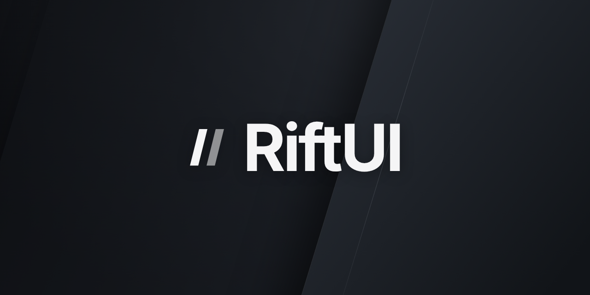

# RiftUI

A dock-style UI library for Roblox script hubs. Floating panels, a command palette, live theming, and a browser simulator to build it all without launching a game.



[Documentation](https://riftui.naymmm.lol) · [Examples](examples/hub.luau) · [Simulator](https://riftui.naymmm.lol/simulator)

```lua
local Rift = loadstring(game:HttpGet(
    "https://raw.githubusercontent.com/Naymmmm/riftui/main/public/Loader.luau"
))()

local Hub = Rift:CreateHub({ Name = "My Hub", Id = "my-hub" })
local Main = Hub:Tab({ Name = "Main", Icon = "home" })
local Section = Main:Section({ Name = "Controls" })
Section:Button({ Name = "Hello", Callback = function() print("Hello") end })
```

To pin a version, set `getgenv().riftcommit` to a commit SHA before loading.

RiftSim is an optional preview tool included with the docs. To run locally:

```sh
pnpm install
pnpm dev
```

Docs at `http://localhost:5199`, simulator at `http://localhost:5199/simulator`.

[MPL 2.0](LICENSE). Third-party assets keep their own licenses; see [NOTICE](NOTICE).
